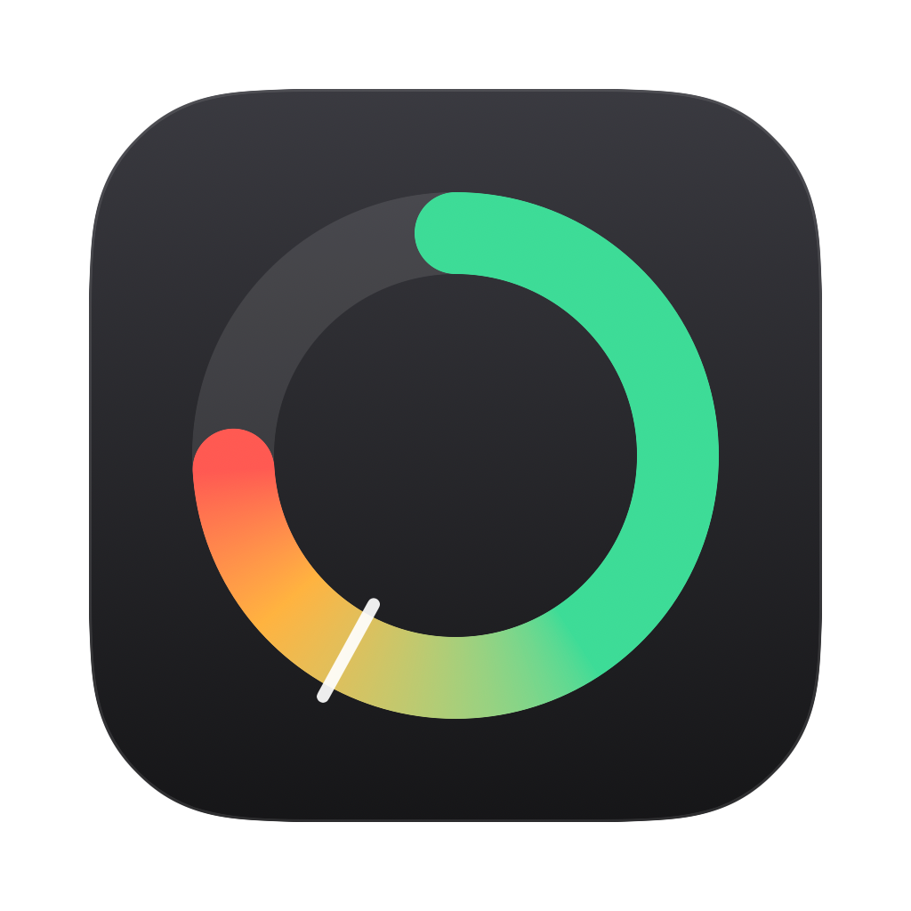
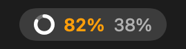
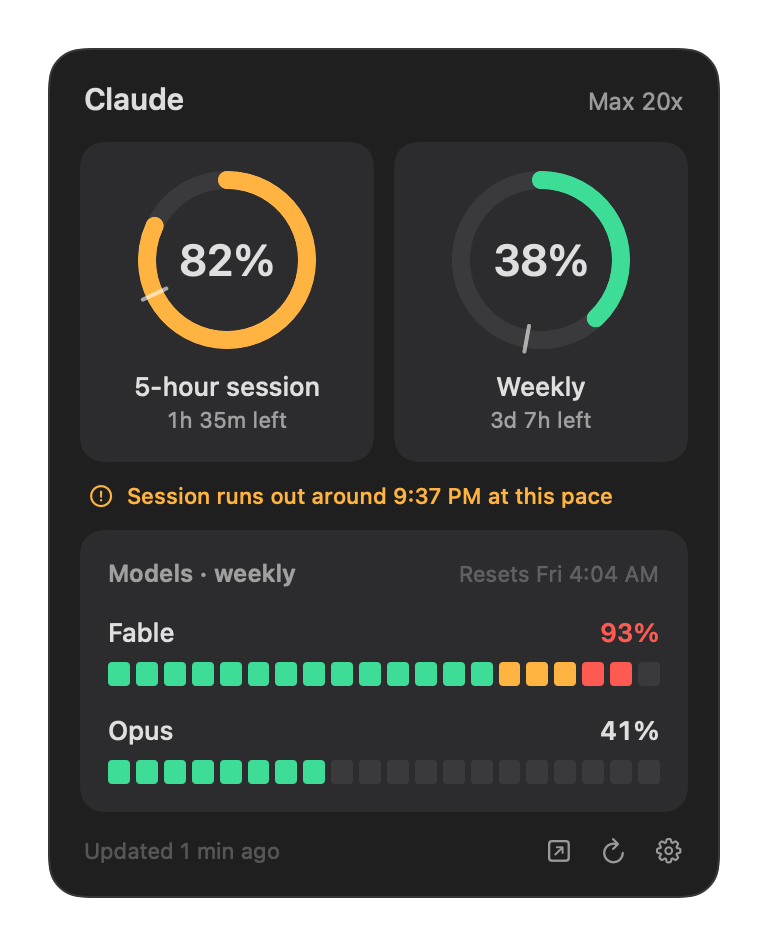
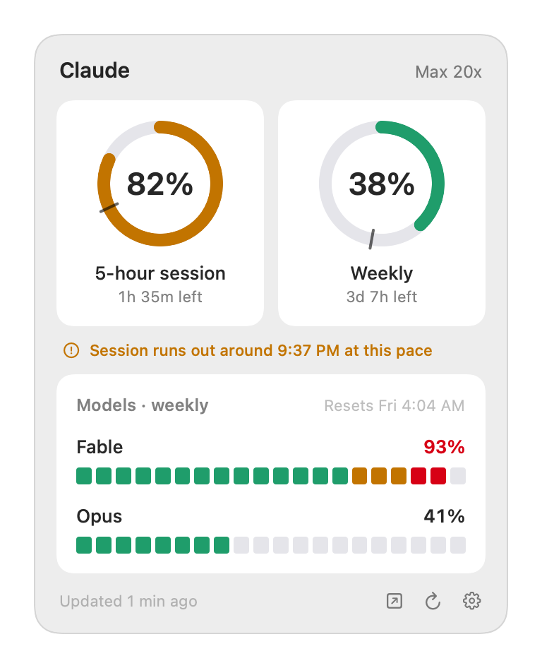

<p align="center"></p>

# Claude Usage

A small native macOS menu bar app that shows your Claude plan limits at a glance:
the 5-hour session, the weekly limit, and any per-model weekly limit, with reset
times and a warning when you're on track to run out.

<p align="center">
  <br>
  
  
</p>

*Screenshots use demo data.*

## What it shows

- **Menu bar:** a ring filled to your session use, plus session and weekly percentages.
  A number turns amber at 75% and red at 90%.
- **Rings** for the 5-hour session and the weekly limit, with time left until each resets.
  The small tick on each ring marks where an even pace would be.
- **Per-model weekly limits** as segmented bars, whenever your plan has them.
- **A pace warning** when a limit will run out before it resets at your current rate.
  It waits until a quarter of the window has passed, because usage comes in bursts.
- Light and dark mode, VoiceOver labels, and Open at Login.

Native Swift and SwiftUI. No Electron, no dependencies, no background helpers.

## Requirements

- macOS 15 or later (Apple Silicon or Intel)
- [Claude Code](https://claude.com/claude-code) signed in with a Claude
  Pro or Max account. The app reads the login Claude Code already stores.

## Install

### Build from source (recommended)

Needs the Xcode command line tools (`xcode-select --install`).

```bash
git clone https://github.com/HimashaHerath/claude-usage-bar.git
cd claude-usage-bar
make install
```

That builds a universal app, copies it to `~/Applications` and launches it.

### Download

Grab `ClaudeUsage.zip` from the [latest release](https://github.com/HimashaHerath/claude-usage-bar/releases/latest),
unzip it and move **Claude Usage** to Applications. The release is not notarized
(that needs a paid Apple developer account), so macOS will refuse to open it the
first time. Either open **System Settings → Privacy & Security** and click
**Open Anyway**, or run:

```bash
xattr -dr com.apple.quarantine "/Applications/Claude Usage.app"
```

### No Keychain prompt

Claude Code saves its login with Apple's `security` tool, and Claude Usage reads
it back through that same tool, which macOS already trusts. Asking the Keychain
directly would mean a password prompt after every rebuild, and again each time
Claude Code renews its login.

## How it works, and your privacy

1. It reads Claude Code's OAuth token from the Keychain item `Claude Code-credentials`
   (via `/usr/bin/security find-generic-password`), or from
   `~/.claude/.credentials.json` if that's where Claude Code keeps it.
2. It asks `https://api.anthropic.com/api/oauth/usage` for your current limits. That
   is the endpoint behind Claude's own usage page.
3. It refreshes every 3 minutes, when your Mac wakes, and when you open the panel
   if the numbers are over a minute old. If Anthropic rate-limits it, it backs off
   to 10 minutes and keeps showing the last numbers.

The token stays in memory. It is sent only to `api.anthropic.com`, and it is never
logged, written to disk or sent anywhere else. The app reads no conversations,
keeps no history and has no analytics. The networking and Keychain code is all
in [`Sources/Core.swift`](Sources/Core.swift), about 200 lines.

The access token only lasts a few hours, and Claude Code renews it when it runs.
If you mostly use the Claude desktop app, the stored terminal login can go stale.
When it's about to expire, Claude Usage runs `claude -p --no-session-persistence /usage`
in the background. That's a local Claude Code command: it makes no model call
and costs no usage, but Claude Code renews and stores its own login first.
Claude Usage never refreshes the token itself, because that would sign Claude
Code out. If the `claude` command isn't installed, the panel asks you to run
`claude` once in Terminal.

## Good to know

- **This is an unofficial project**, not made or endorsed by Anthropic. The usage
  endpoint is not publicly documented and could change. If it does, the panel
  shows an error instead of numbers.
- It shows plan limits only. It doesn't estimate API spend.

## Development

```bash
make demo          # fake data, no Keychain access, panel opens on launch
make screenshots   # renders docs/*.png from demo data
make zip           # universal, ad-hoc-signed build/ClaudeUsage.zip
```

The code is four files in `Sources/`: `Core.swift` (token, API, model),
`Store.swift` (polling), `Views.swift` (the panel) and `main.swift` (menu bar item).
Issues and pull requests are welcome.

## License

[MIT](LICENSE)
